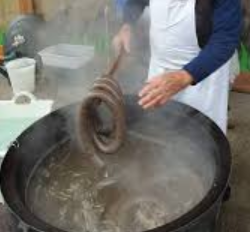
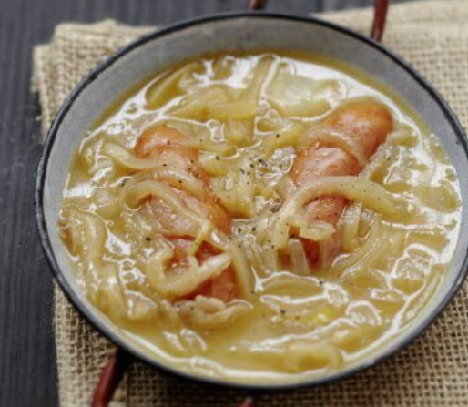
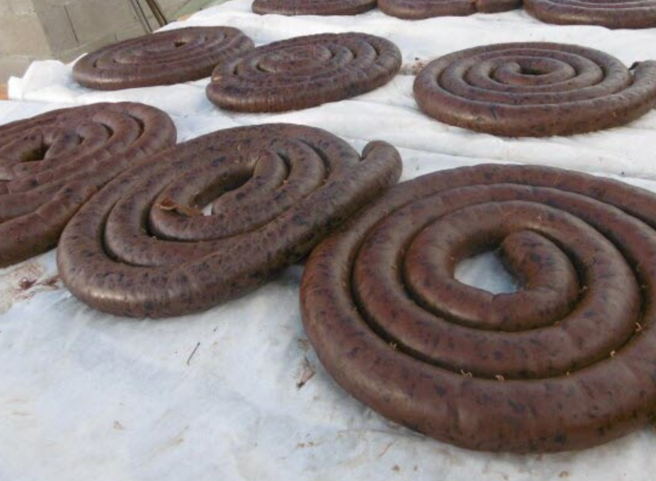
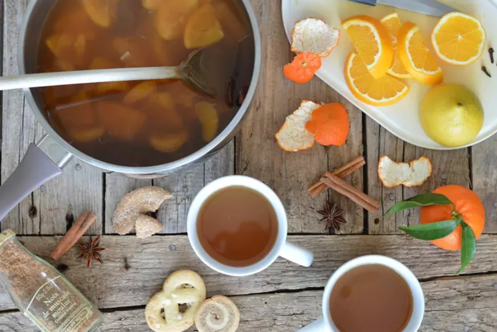

<h5>
🔥 Matinée Boudin/Diots à la chaudière 🔥
  
📅 Dimanche 8 novembre, dès 9h
  
📍 Salle des fêtes de Sainte-Anne-sur-Gervonde
  
Venez déguster du boudin noir cuit à la chaudière et de bons diots mijotés au vin blanc et aux oignons.
</h5>

<h5>
<li>2.5€ la part de boudin</li>
<li>10€ l'assiette de boudin (un peu plus de 4 parts)</li>
<li>3€ le diot</li>
  
Pré-commande conseillée, jusqu'au samedi 7 novembre !
  
Pour réserver, c'est simple : un mail sur <a href="mailto:ape.steanne@gmail.com">ape.steanne@gmail.com</a> avec
<li>Nom / Prénom</li>
<li>Produits</li>
<li>Quantités</li>
  
Vous recevrez un numéro de commande et le montant en retour comme validation.
Plus qu'à venir la chercher le matin du 08/11 et nous la régler (espèces ou chèque).
</h5>

<h5>
<table>
  <tr>
    <th width="250">
      
    </th>
    <th rowspan="2">
      
    </th>
  </tr>
  <tr>
    <th width="250">
      
    </th>
  </tr>
</table>
<h6>Photos non contractuelles</h6>
</h5>

<h5>
Du vin chaud vous sera également proposé si les températures sont assez fraîches.

<h6>Photo non contractuelle</h6>
</h5>

<h5>
🧁 C'est aussi le dernier jour pour commander vos <a href="/APE/Year2026/bijou_nov_2026">madeleines Bijou</a> !
</h5>

