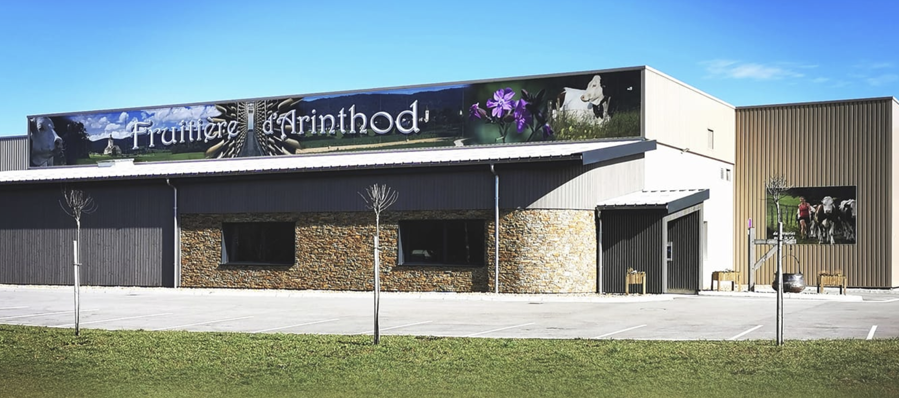
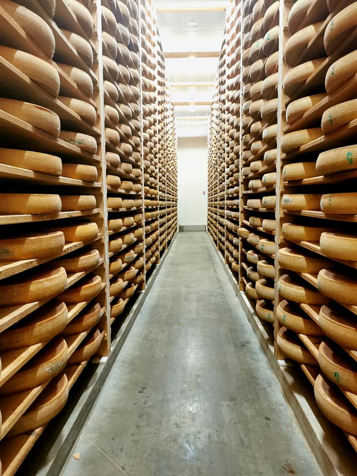
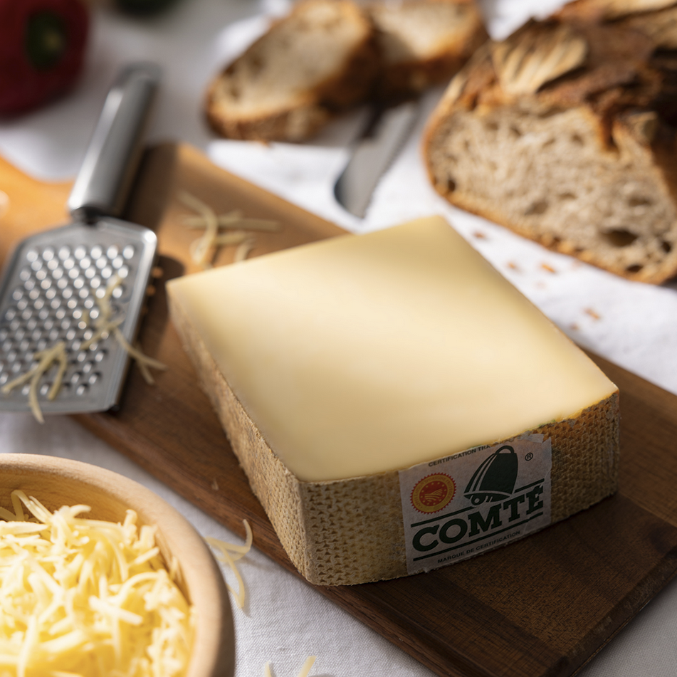
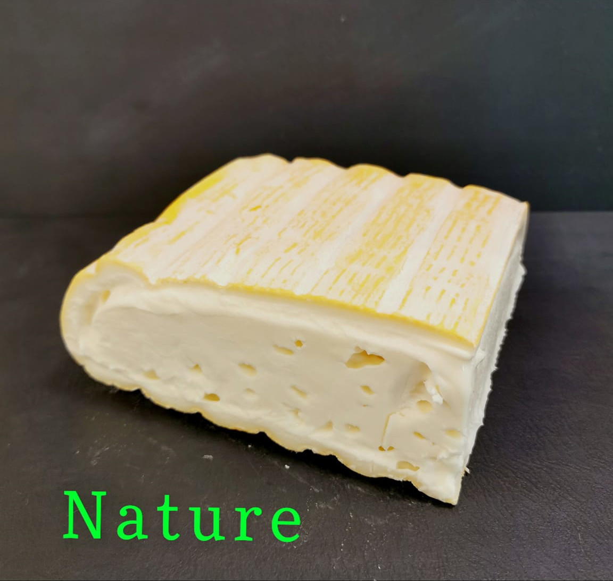
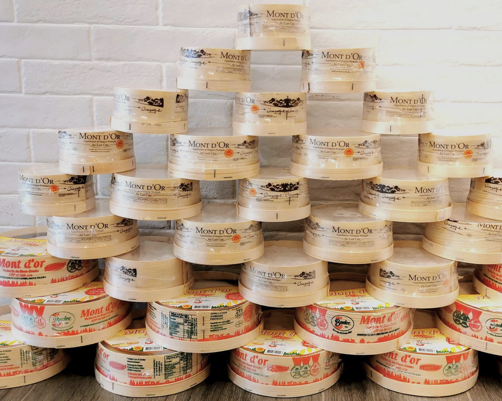

<h5>
🧀 Vente de fromages de la fruitière d'Arinthod 🧀
  
Comtés, morbiers, raclettes, monts d'or, cancoillottes, et leur spécialité, le « Moelleux d'Arinthod », qui a un peu la texture d'un reblochon.
  
⏳ <b>Date limite de commande : vendredi 11 décembre</b>
  
📦 <b>Livraison : vendredi 18 décembre, lors des illuminations de la mairie</b>
</h5>

Les produits à la coupe peuvent avoir des fluctuations de poids de 5 %.
  
Possibilité de recevoir les fromages à la coupe sous vide avec un supplément de 0,50 € par produit.

<h5>
Pour commander, 2 solutions :
<li>Commande et paiement en ligne via <a href='https://www.helloasso.com/associations/association-des-parents-d-eleves-de-l-ecole-publique-de-sainte-anne-sur-gervonde/boutiques/ape-ste-anne-fromage-hiver-2026' target='_blank'>HelloAsso</a> (les dons sont possibles mais non obligatoires)</li>
<li>Déposer le bon de commande dans la boîte aux lettres de l'APE devant l'école, avec le règlement par chèque à l'ordre de « APE Sainte Anne »</li>
  
Une question ? Écrivez-nous : <a href="mailto:ape.steanne@gmail.com">ape.steanne@gmail.com</a>
</h5>

<h5>
Voici le lien pour commander sur Hello Asso directement :
  
<a href='https://www.helloasso.com/associations/association-des-parents-d-eleves-de-l-ecole-publique-de-sainte-anne-sur-gervonde/boutiques/ape-ste-anne-fromage-hiver-2026' target='_blank' style="display: block; text-align: center; padding: 0.8em 2em; border-radius: 999rem; background: var(--gradient-accent-orange); color: var(--accent-text-over); text-decoration: none; box-shadow: var(--shadow-md);">🧀 Commander sur HelloAsso</a>
</h5>

Le bon de commande (cliquer pour télécharger) :

<h5>Vous allez vous régaler !</h5>

  

<table>
    <tr>
        <th width='300'>
          
        </th>
        <th width='300'>
          
        </th>
      </tr>
      <tr>
        <th width='300'>
          
        </th>
        <th width='300'>
          
        </th>
      </tr>
  </table>

